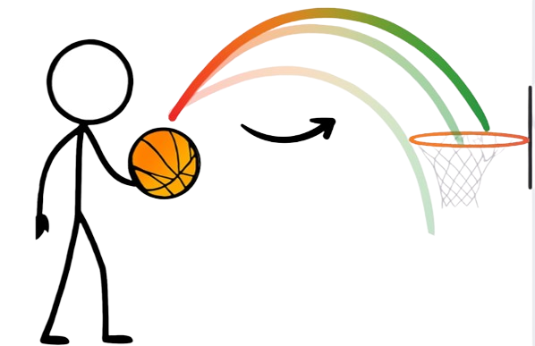
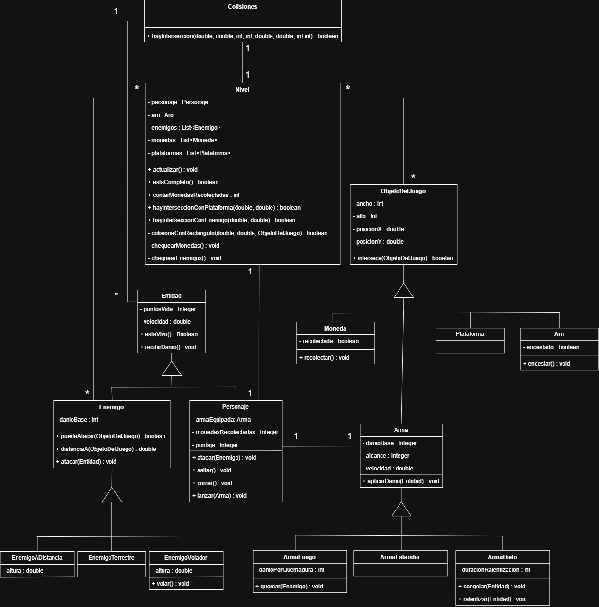
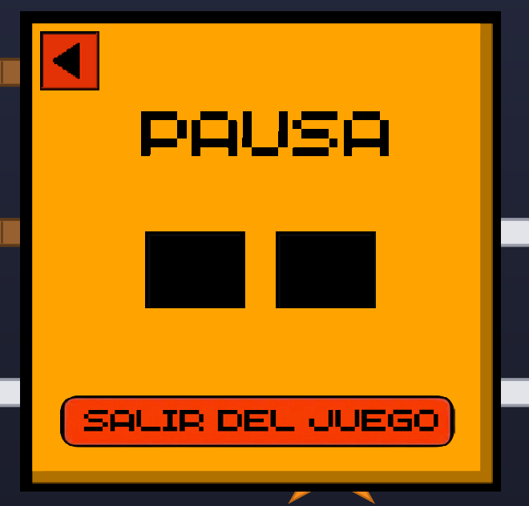
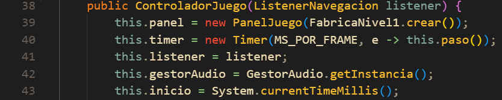
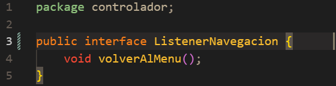
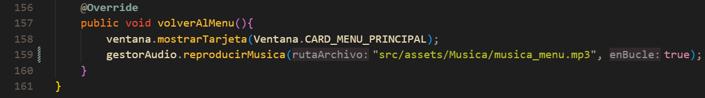
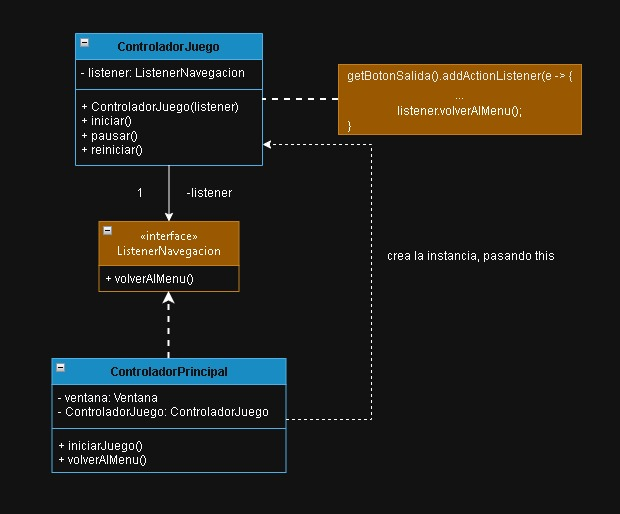
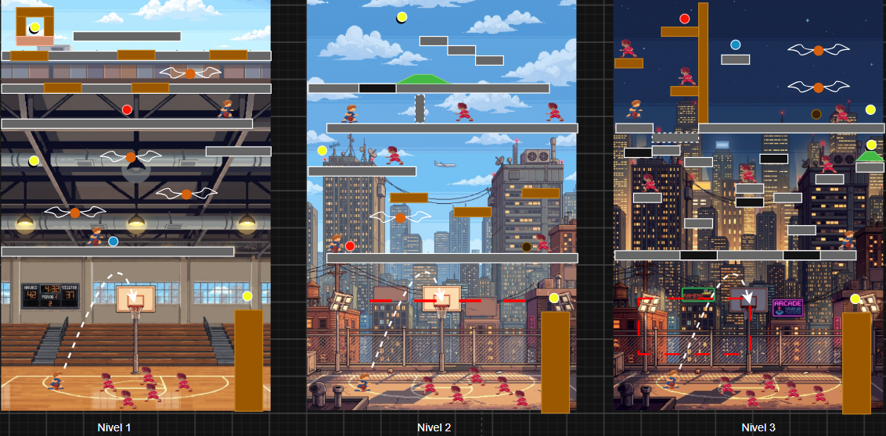

# Proyecto: Platformer - "Basketball fever"

## 1. Integrantes del Equipo
- Bahamonde, Franco
- Flores, Judith
- Musso, Miguel
- Parisi, Franco

## 2. Dominio y Alcance del Sistema

### Descripción del Problema
Se busca desarrollar una aplicación de escritorio del clasico Juego de plataformas. El jugador toma el lugar de un basquetbolista inmerso en un mundo de fantasía ambientado con la tematica de dicho deporte. En cada uno de los tres niveles se deberá avanzar verticalmente por un mapa extenso (diferenciado en escenarios), atravesando distintos obstaculos y enemigos hasta llegar a la meta final. 

### Objetivo del Sistema
El sistema será un juego funcional y extensible que permitirá al jugador experimentar las mecánicas básicas del género. El diseño debe ser escalable para facilitar la adición de nuevos tipos de enemigos, puzzles, personajes o mapas en el futuro, aplicando rigurosamente los conceptos del paradigma orientado a objetos. 

### Funcionalidades Principales (Features)

- **Sistema de progresión de dificultad**
    - Los enemigos incrementan sus atributos a medida que se avance de nivel.
    - Los obstaculos aumentan progresivamente a medida que se avance en el juego.

- **Mecánicas de Juego**
    - El jugador empieza con 0 monedas iniciales, las cuales tendra que ir recolectando entre niveles, debiendo recolectar una cantidad de monedas determinada para poder avanzar al siguiente nivel.

    - Para recolectar una moneda, el jugador deberá tocarlas, lo cual se verá obstaculizado por la aparición de enemigos, si lo logra, avanza al siguiente escenario hasta llegar al final del nivel.
    

    - El puntaje del jugador se calculará en función del tiempo en el que completa el nivel y enemigos derrotados.

- **Sistema de combate**
    - El jugador tiene como arma principal una pelota de basquet, la cual arroja a los enemigos para derrotarlos, la pelota puede lanzarse en cualquier dirección.
    - Si el enemigo esta lo suficientemente cerca el jugador podra combatir cuerpo a cuerpo.

- **Interfaz Gráfica (IGU):**
    - Contador de tiempo
    - Vidas
    - Puntaje
    - Monedas recogidas / monedas totales

## 3. Arquitectura y Diseño

### Diagramas de Diseño

#### **Diagrama de Clases UML (Conceptual)**

 

#### Patrón de diseño adicional: State
**Nombre del patrón: State (Estado)** 
- **Justificación:** Se utiliza el patrón State para representar los distintos estados internos de una partida y evitar que ControladorJuego concentre la lógica de cada estado mediante flags e ifs dispersos.

Existía el problema inicial de desconocimiento entre **controladorJuego** y **controladorPrincipal** al momento de tener que pasar del menu de pausa y la vista del juego  ( **PanelPausa** + **PanelJuego** ) a la vista del menu principal **PanelMenuPrincipal** a través del boton de "Salir del juego". 
 

Por eso mismo aplicando **Observer** se hizo que:
- **ControladorJuego** fuera el observado, recibiendo el listener por constructor 

- **ControladorPrincipal** el observador implementando la interfaz **ListenerNavegacion** con el metodo abstracto **volverAlmenu()**

El cual es llamado cuando el usuario presiona el boton de salida desde el menu de pausa
**ControladorPrincipal** haciendo override de dicho metodo, ejecuta el cambio de vista a CARD_MENU_PRINCIPAL y cambia la musica.

- En **ControladorPrincipal:**
 

- **Diagrama de clases:**

#### **Prototipo Visual**
 #### Prototipo y descripción de escenario:
 

 - **Primer escenario:** Para el primer escenario de cada nivel, el jugador debe encestar en el aro para que el pilar que contiene la moneda descienda y esta sea recolectada, pasando al siguiente escenario. 
 - Dicho aro es estatico en el primer nivel, en los niveles posteriores se moverá en un patron determinado, dificultando encestar.
 - **Plataformas especiales:** Las plataformas de color **negro**, son plataformas las cuales no colisionan con la pelota, es decir, puede pasar a través de ellas.
 - Las plataformas de **madera** (color marron) pueden ser destruidas por la pelota de fuego (color rojo).
 - Las plataformas **botón** (color verde), al ser accionadas por la pelota, destruyen una plataforma determinada, la cual libera el paso.

## 4. Stack Tecnológico
- **Lenguaje:** Java 25
- **IDE:** Visual Studio Code
- **Base de Datos:** SQLite
- **Framework de IGU:** Java Swing y JavaFX
- **Control de Versiones:** Git y GitHub Classroom
